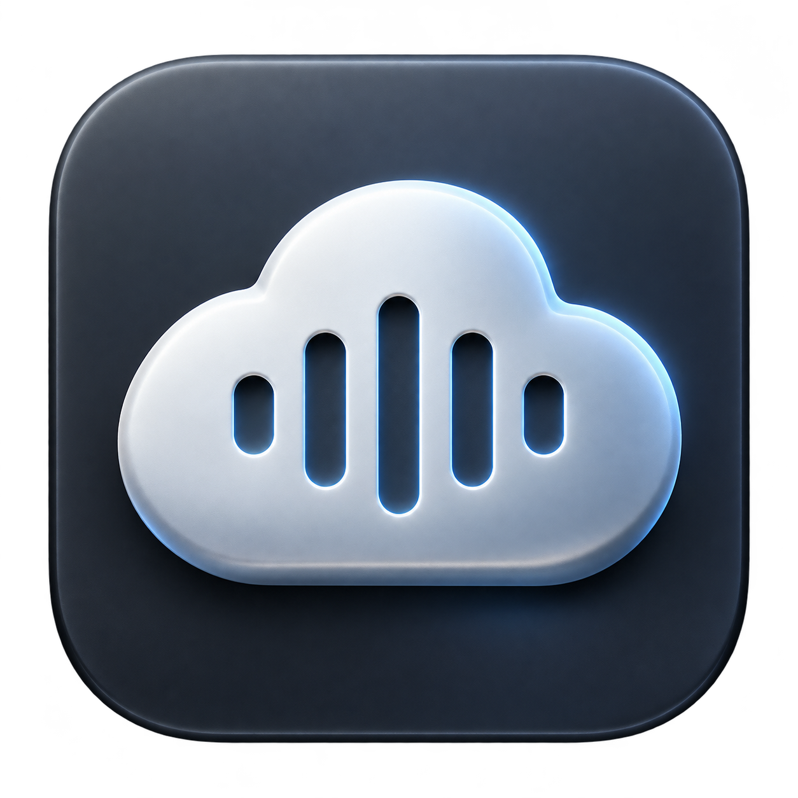

<p align="center">
  
</p>

<h1 align="center">Claude Narrator</h1>
<p align="center"><strong>Let Claude finish. Listen to what changed.</strong></p>
<p align="center">A native macOS companion that gives Claude Code a voice.</p>

[Download for Apple Silicon](https://github.com/HarrisHan/claude-narrator/releases/latest) · [简体中文](docs/README.zh-CN.md) · [Report a bug](https://github.com/HarrisHan/claude-narrator/issues)

 

When Claude Code finishes a turn, Claude Narrator speaks its reply aloud. Keep your attention on your work and hear the result without switching back to the terminal.

The default mode preserves the reply's prose and order instead of summarizing it again. Markdown, code blocks and URLs are cleaned up for listening; long file paths are shortened.

### Built for listening

- **Natural voices:** four Chinese neural voices, with macOS speech as an offline fallback.
- **You control playback:** pause, resume, stop, replay, mute and adjustable speed.
- **No second summary:** no four-sentence or 360-character limit in the default narration mode.
- **Optional spoken phrasing:** on-device rewriting when Apple Intelligence is available; longer replies and unavailable models fall back to cleaned original text.
- **Always within reach:** a menu bar control, global shortcuts and optional launch at login.

### Download and try

1. Download `Claude-Narrator-macOS-arm64.zip` from [Releases](https://github.com/HarrisHan/claude-narrator/releases/latest) and unzip it.
2. Move `Claude Narrator.app` to Applications and open it. The early-access build is ad-hoc signed, not Apple-notarized. If macOS blocks it, review it in **System Settings → Privacy & Security → Open Anyway** only if you trust this release.
3. In Terminal, run `python3 /path/to/unzipped-folder/install-hook.py` (replace the path). Restart Claude Code to load the hook.
4. Complete a Claude Code turn and listen. System speech works without additional Python packages; install the optional natural voice component below for the four neural voices.

The downloadable build is for **Apple Silicon**. Intel Macs can try building from source; Intel compatibility is unverified. Python 3 is required for hook setup.

### Build from source

Requirements: macOS 15+, Xcode command-line tools with a Swift 5.10+ compatible toolchain, Python 3 for hook setup, and a Claude Code version supporting HTTP `Stop` hooks with `last_assistant_message`. On-device phrasing additionally requires macOS 26 and an available Apple Intelligence model. The current voice picker is focused on Mandarin Chinese.

```sh
git clone https://github.com/HarrisHan/claude-narrator.git
cd claude-narrator
./scripts/build-app.sh
mkdir -p "$HOME/Applications"
ditto "dist/Claude Narrator.app" "$HOME/Applications/Claude Narrator.app"
open "$HOME/Applications/Claude Narrator.app"
python3 scripts/install-hook.py
```

The installer backs up `~/.claude/settings.json`, adds the localhost hook and replaces the earlier `speak_last_reply.py` narrator hook if present. Other hooks remain in place. Restart your Claude Code session if needed to load the hook.

For optional natural neural voices, install `edge-tts` in the location the app detects:

```sh
python3 -m venv "$HOME/.claude/hooks/tts-venv"
"$HOME/.claude/hooks/tts-venv/bin/python" -m pip install edge-tts
```

You can also use an existing `edge-tts` executable at `/opt/homebrew/bin/edge-tts` or `/usr/local/bin/edge-tts`. Without it, the app uses system speech.

The early-access app uses an ad-hoc signature, not Apple notarization. Only the current developer's Mac has been checked; broader compatibility testing is still needed.

### Controls

| Shortcut | Action |
| --- | --- |
| `⌃⌥Space` | Pause / resume |
| `⌃⌥M` | Mute |
| `⌃⌥S` | Stop |
| `⌃⌥R` | Replay |

### Data flow

Claude Code sends the final reply to `127.0.0.1:17832`. Formatting cleanup and optional Apple on-device rewriting run locally. **Natural neural speech sends the narration text to Microsoft's online speech service through `edge-tts`.** Turn off natural neural speech to use macOS system voices. Generated neural audio is cached locally. The app does not require its own AI API key.

### Development

```sh
swift test
./scripts/build-app.sh
```

Open `Package.swift` in Xcode to work on the app. Icon sources and generation notes live in `docs/brand/` and `Resources/`.

To remove the hook:

```sh
python3 scripts/uninstall-hook.py
```

Claude Narrator is an independent project and is not affiliated with Anthropic or Microsoft.

### Help shape the project

If Claude Narrator makes your workflow easier, a GitHub star helps other developers discover it. Setup feedback is especially valuable: [tell us what worked or failed](https://github.com/HarrisHan/claude-narrator/issues). Contributions are welcome under the [MIT license](LICENSE).
